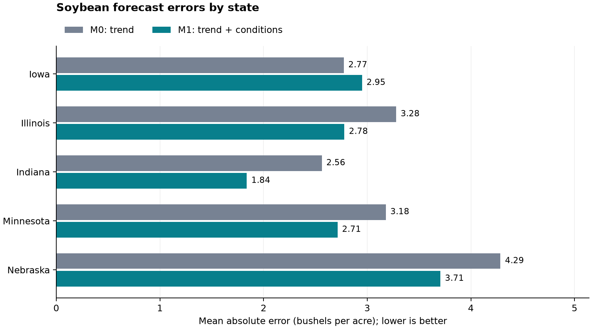

# US Soybean Yield Forecasting with USDA Crop Conditions

Do late-July crop-condition surveys improve an August 1 forecast of final annual
soybean yield over a simple historical trend?

This project evaluates that question for Iowa, Illinois, Indiana, Minnesota,
and Nebraska using USDA NASS data and an expanding-window backtest.

**Result:** adding Good + Excellent condition and its four-week change reduced
out-of-sample MAE by **13.01%** and RMSE by **15.15%** across 55 state-year
forecasts for 2015-2025. Both metrics improved in four states and worsened in
Iowa. The augmented model also had a larger average underprediction overall.

[Full results and figures](docs/results_summary.md)



## Results

| Model | Forecasts | MAE (bu/acre) | RMSE (bu/acre) | Mean error (bu/acre) |
| --- | ---: | ---: | ---: | ---: |
| M0: state-specific trends | 55 | 3.2156 | 4.1914 | -0.7867 |
| M1: trends + crop conditions | 55 | 2.7973 | 3.5565 | -1.0074 |

Errors are forecast minus actual. Negative mean error indicates average
underprediction. Lower MAE/RMSE is better; reduced absolute error does not
necessarily imply reduced signed bias. Each state-year receives equal weight.

| State | M0 MAE | M1 MAE | MAE reduction |
| --- | ---: | ---: | ---: |
| Iowa | 2.7737 | 2.9497 | -6.35% |
| Illinois | 3.2785 | 2.7798 | 15.21% |
| Indiana | 2.5616 | 1.8379 | 28.25% |
| Minnesota | 3.1791 | 2.7133 | 14.65% |
| Nebraska | 4.2852 | 3.7060 | 13.52% |

These are descriptive results from this evaluation sample. The report also
examines differences by year and the largest individual forecast misses.

## Data and timing

Source: [USDA NASS Quick Stats](https://www.nass.usda.gov/Quick_Stats/).

- Geography: five states, with one modeling observation per state and year.
- Historical sample: 2000-2025, giving 130 complete annual yield observations.
- Outcome: final annual soybean yield, measured in bushels per acre.
- Forecast date: August 1 in each held-out year.
- Condition date: the latest common valid survey week ending on or before July 25.
- GE: the percentage rated Good plus the percentage rated Excellent, on a 0-100 scale.
- Four-week change: current GE minus GE exactly 28 calendar days earlier, in percentage points.

Required current and comparison condition observations were available for all
26 years. The earlier GE value is retained for audit but is not also included
as a third condition predictor.

The small analysis snapshot is stored in data/processed/model_panel.csv, with
its provenance in model_panel_metadata.json. Original exports, the SQLite
database, and the Python environment are generated or collected locally.
Download dates and query notes belong in [data_collection.md](docs/data_collection.md).

## Models

For state i and harvest year t, M0 estimates a separate intercept and linear
trend for each state:

$$
y_{it}=\alpha_i^{(0)}+\delta_i^{(0)}(t-2000)+\varepsilon_{it}^{(0)}.
$$

M1 estimates its own state intercepts and trends, plus two condition coefficients
shared across states:

$$
y_{it}=\alpha_i^{(1)}+\delta_i^{(1)}(t-2000)
+\beta_1 GE_{it}+\beta_2\Delta GE_{it}^{4w}+\varepsilon_{it}^{(1)}.
$$

All coefficients are estimated jointly by ordinary least squares, separately
for each model and forecast year. M0 has 10 coefficients; M1 has 12.

The design matrix contains explicit state indicators and state-by-time terms.
scikit-learn LinearRegression uses fit_intercept=False because the state
intercept columns are already present. The year offset is fixed, not estimated
from the full sample. No full-sample detrending or feature scaling is performed.

## Backtest design

| Training period | Held-out year | Training rows | Test rows per model |
| --- | --- | ---: | ---: |
| 2000-2014 | 2015 | 75 | 5 |
| 2000-2015 | 2016 | 80 | 5 |
| ... | ... | ... | ... |
| 2000-2024 | 2025 | 125 | 5 |

The models are refitted using earlier years, then predict all five states in
the next year. The held-out year's final yield is used only for scoring that
year's forecasts. The process yields 55 forecasts per model across 11 years.

There is no random state-year split. The comparison uses the same training
years, test observations, and information cutoff for both models.

## Reproduce the analysis

From the repository root, using Python 3.13:

```bash
python3.13 -m venv .venv
source .venv/bin/activate
python -m pip install -r requirements-lock.txt
python src/run_backtest.py
python src/report_results.py
```

The environment is created once for this checkout. For an existing installation,
activate its environment and run the two analysis scripts.

requirements-lock.txt records the development environment's installed versions;
requirements.txt contains the dependency ranges. The analysis snapshot lets a
reviewer reproduce the backtest without downloading the raw USDA exports first.

The backtest saves individual forecasts, overall/state/year metrics, fold
coefficients, and metadata under outputs/tables. Reporting validates those
outputs, creates a Markdown report, and saves three figures as PNG and PDF under
outputs/figures. The three selected PNGs are versioned for viewing on GitHub.

## Rebuild from the raw USDA exports

Use Quick Stats with Program SURVEY, Sector CROPS, Group FIELD CROPS, Commodity
SOYBEANS, geographic level STATE, Domain TOTAL, years 2000-2025, and the five
states above. Use the overall series covering all production practices.

| Raw file in data/raw | Data item | Frequency |
| --- | --- | --- |
| soybean_yield_annual.csv | SOYBEANS - YIELD, MEASURED IN BU / ACRE | ANNUAL, reference period YEAR |
| soybean_condition_good.csv | SOYBEANS - CONDITION, MEASURED IN PCT GOOD | WEEKLY |
| soybean_condition_excellent.csv | SOYBEANS - CONDITION, MEASURED IN PCT EXCELLENT | WEEKLY |

Retain Week Ending in weekly exports and include the July survey weeks and their
exact four-week comparisons. Keep original files unchanged and record the
actual download dates and filters in docs/data_collection.md.

```bash
python src/inspect_yield_csv.py data/raw/soybean_yield_annual.csv
python src/inspect_condition_csvs.py data/raw/soybean_condition_good.csv data/raw/soybean_condition_excellent.csv
python src/load_data.py
python src/build_model_panel.py
python src/run_backtest.py
python src/report_results.py
```

The loader initializes the SQLite tables as needed. Validators check series,
units, geography, coverage, duplicate keys, missing values, percentage bounds,
and exact date matching. The panel builder opens source tables read-only.
SQL selects common survey dates and joins the condition observations and annual
yield labels. Missing survey weeks are not silently filled from later data.

New downloads may contain revisions and need not reproduce the committed
snapshot exactly. Use the included snapshot to reproduce the reported results.

## Repository guide

| Location | Role |
| --- | --- |
| config/project.json | State coverage, year range, and timing assumptions |
| sql/01_create_tables.sql | SQLite table definitions |
| sql/02_build_model_panel.sql | Common survey dates, exact four-week joins, and annual yield joins |
| src/load_data.py | Validated, repeatable CSV-to-SQLite loading |
| src/build_model_panel.py | Analysis panel and provenance metadata |
| src/run_backtest.py | OLS estimation and expanding-window evaluation |
| src/report_results.py | Saved-result validation, figures, and report |
| docs/results_summary.md | Detailed findings and figures |
| docs/model_backtest.md | Model specification and evaluation details |
| data/processed/model_panel.csv | Small analysis snapshot for reproduction |

Tools used: Python, pandas, NumPy, scikit-learn, Matplotlib, SQLite/SQL, and Git.

## Interpretation and limitations

- Historical records can contain revisions. The seasonal cutoff is not a
  reconstruction of the exact original release vintages or release dates.
- There are 11 held-out years, and states within a year can share shocks.
  Descriptive error reductions do not establish statistical significance.
- Condition coefficients are predictive associations, not causal effects.
- State-level yield is one component of crop supply. Harvested area would be
  needed for production estimates; export availability requires further data.

AI assistance supported code development and documentation. Forecasts come
from the stated OLS models, and the accuracy figures come from the historical
held-out observations. Explicit data checks and forecast timing rules make the
workflow reviewable.
