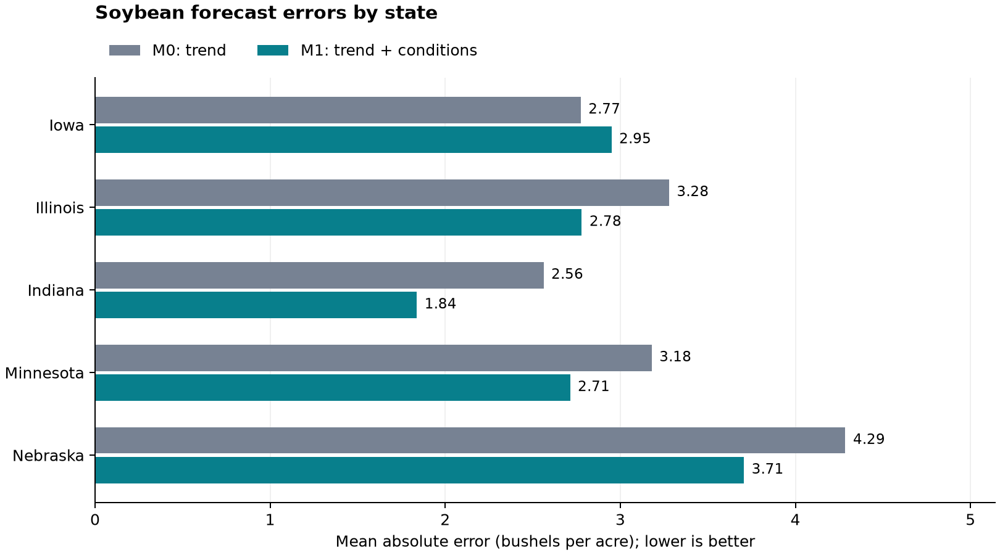
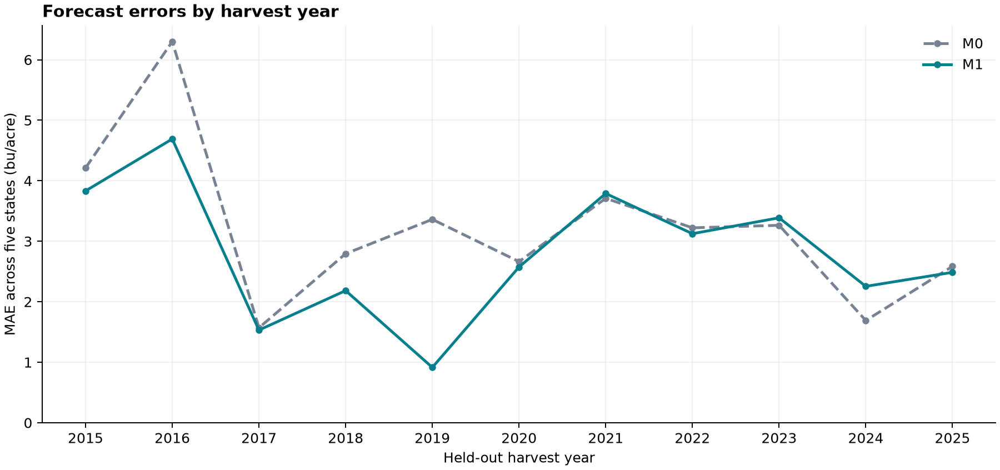
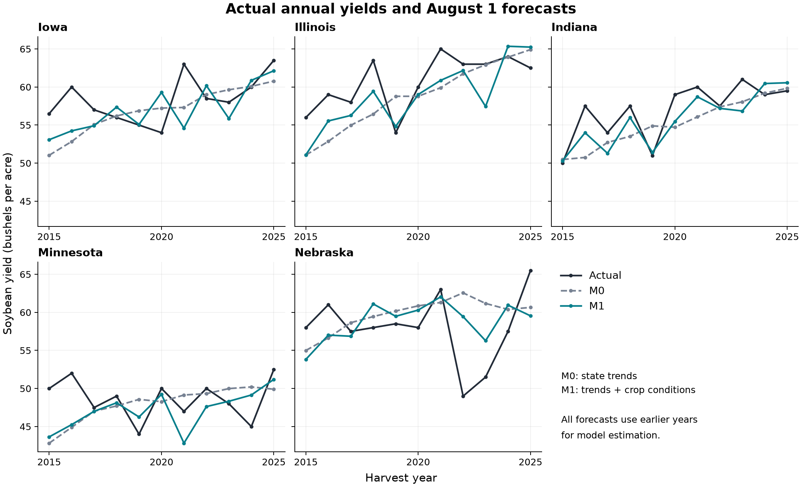

# Do crop-condition surveys improve August soybean yield forecasts?

This project compares state-specific linear trends (M0) with trends plus USDA
Good + Excellent condition and its four-week change (M1). The evaluation covers
55 held-out state-year observations in 5 states from 2015 through 2025.

M1's overall MAE reduction relative to M0 is **13.01%**; its RMSE reduction
is **15.15%**. Positive reductions indicate improvement; negative values
indicate deterioration. These results apply to this historical evaluation sample.

## Data and forecast design

- States: Iowa, Illinois, Indiana, Minnesota, Nebraska.
- Training data begin in 2000. One observation per state and harvest year.
- Target: final annual soybean yield, in bushels per acre.
- Condition inputs: the latest common valid survey week on or before July 25,
  plus the change from exactly 28 days earlier. GE uses a 0-100 percentage scale.
- Forecast date: August 1. Both models are re-estimated using only earlier years.
- First test: train 2000-2014, predict 2015; last test: train 2000-2024, predict 2025.
- M0 estimates five intercepts and five state trends. M1 jointly estimates its own
  state intercepts/trends and two condition coefficients shared across states.
- Metrics give equal weight to each held-out state-year. Detailed methodology:
  [model_backtest.md](model_backtest.md).

## Overall accuracy

| Model | Forecasts | MAE | RMSE | Mean signed error |
| --- | ---: | ---: | ---: | ---: |
| M0 | 55 | 3.2156 | 4.1914 | -0.7867 |
| M1 | 55 | 2.7973 | 3.5565 | -1.0074 |

All errors are in bushels per acre. Signed error is forecast minus actual:
negative mean error indicates average underprediction. Lower MAE/RMSE is better;
mean error measures the direction of bias and should be assessed separately.

## Differences across states

| State | M0 MAE | M1 MAE | MAE reduction | RMSE reduction |
| --- | ---: | ---: | ---: | ---: |
| Iowa | 2.7737 | 2.9497 | -6.34% | -6.14% |
| Illinois | 3.2785 | 2.7798 | 15.21% | 19.74% |
| Indiana | 2.5616 | 1.8379 | 28.25% | 31.54% |
| Minnesota | 3.1791 | 2.7133 | 14.65% | 11.14% |
| Nebraska | 4.2852 | 3.7060 | 13.52% | 19.50% |

M1 has lower MAE in 4/5 states and lower RMSE in
4/5 states. States where MAE worsened: Iowa.



## Differences across years

M1 has lower average absolute error across states in 8/11
test years. The following reductions are M0 MAE minus M1 MAE; positive is better for M1.

- Largest annual MAE reductions: 2019: +2.447 bu/acre; 2016: +1.610 bu/acre; 2018: +0.610 bu/acre.
- Smallest annual MAE reductions: 2024: -0.565 bu/acre; 2023: -0.124 bu/acre; 2021: -0.080 bu/acre.



## Yield paths and largest M1 misses



The table lists the five largest absolute M1 misses. Differences alone do not
identify their causes; attributing a miss to weather or survey error needs further evidence.

| State | Year | Actual yield | M0 forecast | M1 forecast | M1 signed error |
| --- | ---: | ---: | ---: | ---: | ---: |
| NE | 2022 | 49.00 | 62.56 | 59.44 | +10.44 |
| IA | 2021 | 63.00 | 57.32 | 54.60 | -8.40 |
| MN | 2016 | 52.00 | 44.90 | 45.25 | -6.75 |
| MN | 2015 | 50.00 | 42.82 | 43.64 | -6.36 |
| NE | 2025 | 65.50 | 60.65 | 59.54 | -5.96 |

## Interpretation and limits

- The comparison measures predictive value in this sample, not causal effects.
- Downloaded historical records may contain revisions. The exercise applies
  seasonal survey-date cutoffs rather than reconstructing original release vintages.
- The sample contains 11 test years; states within a year can share shocks.
  These descriptive comparisons do not establish statistical significance.
- The target is state-level yield. Production also requires harvested area;
  this project does not estimate national output or exports to China.

## Reproduce the report

Run from the existing project with its virtual environment active:

```bash
python src/run_backtest.py
python src/report_results.py
```

The report script validates the saved backtest files and recalculates their
metrics before producing this document. It does not refit models or change data.
All three figures are saved as PNG and PDF under outputs/figures. State and year
comparison tables are saved under outputs/tables. Data collection details are
documented in [data_collection.md](data_collection.md).

This document is generated; keep additional personal notes in a separate file.
